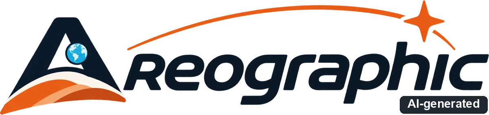

<p align="center"></p>

# Areographic — 화성 탐사 3D 데모 (team navis)

team navis의 NASA Space Apps Challenge 2026 Seoul 제품 저장소입니다. 행사 기간은 2026년 11월 14~15일 KST입니다.

현재 제품 파일로 시작한 공개 스냅샷입니다. 원본의 Git 이력과 과거 테스트 캡처는 포함하지 않습니다. 아래 개발 설명의 과거 브랜치명과 검증 기록은 당시 내용이며, 공개본의 범위와 배포 절차는 [docs/deployment.md](docs/deployment.md)에 있습니다.

## 현재 상태

- `demo/3d-stage1`의 3D 탐사자·로버를 기반으로 한 브라우저 데모입니다. NAVIS / HABITAT ALPHA는 데모 화면 표기이며 최종 제품명은 미확정입니다.
- 시작·관제·실내 보행·외부 탐사는 하나의 실제 3D 월드를 사용합니다. 따뜻한 금속 패널, 작업대, 세 모니터, 화성 창문과 에어록을 절차적 모델로 구성했으며, 현장 대원 시점에서 기지 내부를 `WASD`로 걸을 수 있습니다.
- 벽·천장은 단차가 있는 금속 패널과 체결부, 가구는 접힌 작업대·들어간 문짝·경첩·서랍·운반함 잠금장치로 구성합니다. 도장과 브러시 금속의 표면, 실제 관통창이 있는 에어록 문, 위치와 가림을 반영한 정적 확산 간접광을 적용했습니다.
- 관제실의 세 모니터에서 지형·관측 자료, 경로·임무 계획, 대원·로버 상태를 확인합니다. 모니터를 클릭하면 카메라가 접근하고 화면 안의 세부 탭을 조작할 수 있습니다.
- 실내에서는 벽·책상·의자 등 가구 충돌을 적용하고 마우스 드래그 또는 방향키로 둘러봅니다. 걸어간 곳에서 모니터를 열었다 닫으면 같은 위치로 돌아옵니다. 에어록을 통과하면 기존 헬멧 HUD와 고정 경로 탐사·로버 승하차로 이어집니다.
- 관제와 현장은 같은 브라우저의 임무 상태를 공유합니다. 실내 보행 중에는 EVA 거리·시간·산소가 진행되지 않으며, 선택한 계획과 실내 위치를 유지합니다.
- 탐사 HUD는 `demo/hud-route`의 근거 기반 HUD입니다(녹색 평상 표시, 노랑·빨강 경보, 위쪽 고정 상태 띠, 미니맵, 도착 → 작업 → 기록 → 복귀 → 임무 종료). HUD에는 마우스로 누를 수 있는 항목이 없고 손 조작기 대역 키(`1`·`2`·휠·`M`)와 음성 `V`로 조작합니다. `feat/immersive-mission-control`의 **우주복·임무 상태** 내용(계산 조건, 미연결 센서 항목, 정지 속도 0, 남은 이동 시간 계산값)은 버튼 2 또는 음성 "상세"로 여닫는 표시 전용 층에 들어 있습니다.
- 지형은 보관된 HiRISE/CTX 관측 자료를 사용합니다. 기지·인물·로버와 이동·산소는 가상 또는 모의이며 실시간 센서가 아닙니다.
- 구현: Three.js의 단일 3D 장면, 물리적 모니터 메시의 CanvasTexture 요약, 접근 완료 후 DOM 상세 오버레이, Vite. 이전 2.5D 이미지 장면과 CSS3D 렌더 경로를 대체했습니다. 기존 기지 콘셉트 이미지는 참고 자산으로 보관하며 현재 실행 화면에서는 사용하지 않습니다.
- 이 브랜치(`integrate/immersive`)는 `demo/hud-route`(`80e0e10`)에 `feat/immersive-mission-control`(`04ed300`)을 로컬에서 합친 통합 준비본입니다. 기지 안은 후자를, 기지 밖은 전자를 따릅니다. 선택 근거와 검증은 [integration-immersive.md](docs/integration-immersive.md). 팀 검토 전이며 원격에 올리지 않았습니다.
- 외부 탐사는 Perseverance 실제 주행선(M20 traverse)을 따르는 고정 경로 전진입니다. 도착 확인 → 작업(H2) → 기록(H3) → 복귀(H5) → 기지 도착 → 임무 종료까지 이어집니다. NASA Mark III 우주복은 리깅·보행 주기·착석 자세가 없는 정적 모델입니다.

## 실행

```bash
npm ci
npm run dev
```

브라우저에서 [http://127.0.0.1:5173/](http://127.0.0.1:5173/)를 엽니다. WebGL2를 지원하는 브라우저가 필요합니다. 데이터·모델은 저장소에 포함되어 있으며 NASA API 키는 필요 없습니다.

```bash
npm test       # 실내 보행·충돌·임무·로버·HUD·간접광 계산 검사
npm run build # dist/ 생성
```

빌드가 배포나 공개를 수행하지는 않습니다. 관제실 사용법과 변경 범위는 [immersive-control.md](docs/immersive-control.md), 외부 HUD·경로는 [stage2-hud-route.md](docs/stage2-hud-route.md)와 [hud-design-basis.md](docs/hud-design-basis.md), 기존 탐사자·로버 조작은 [stage1-demo.md](docs/stage1-demo.md), 자료 출처와 한계는 [stage1-data-assets.md](docs/stage1-data-assets.md)를 확인하세요.

## 빠른 시연

1. **관제자**를 선택하고 세 모니터를 클릭하거나 `1`·`2`·`3`을 눌러 상세 화면으로 들어갑니다. `Esc`로 관제석에 돌아옵니다.
2. 중앙 **경로·임무 계획 → 계획 시작**에서 지형 레이어·후보지를 비교합니다. 왼쪽 **과학·관측 자료**에서 고도 단면·정지점·출처를 확인합니다.
3. **대원 시점 · 기지 걷기** 또는 시작 화면의 **현장 대원**을 선택합니다. `WASD`로 실내를 걷고 마우스 드래그·방향키로 둘러봅니다. 모니터를 바라보고 `F` 또는 직접 클릭으로 상세 화면을 열고, `Esc`로 서 있던 위치에 복귀합니다.
4. 왼쪽 에어록을 걸어서 통과하면 외부 탐사 HUD로 전환됩니다. 밖에서는 `W`를 누르는 동안 고정 경로로 전진합니다(실내 `WASD` 자유 보행은 여기서 끝납니다). 로버의 경로상 3m 안에서 멈춘 뒤 `E`로 탑승하고 `Shift`+`W`로 배속 주행, 정지 후 `E`로 내립니다. HUD의 `2`는 우주복·임무 상태 층, `1`은 강조 항목 실행입니다.
5. **역할 전환 → 관제자 → 대원·기지 운영**에서 같은 임무 위치·산소·로버 상태를 확인합니다. 이미 출발한 대원의 시점으로 다시 전환하면 외부 탐사를 이어갑니다.

현재 작업은 `npm test` **31개**와 프로덕션 빌드를 통과했습니다. 이번 실내 모델·간접광 수정은 1512×1243 데스크톱 화면에서 보행·책상 충돌·모니터 클릭/F 진입·로버 상세 탭·Esc 복귀·에어록 통과와 외부 HUD 연결을 확인했습니다. 앞선 HUD·로버 승하차 검증과 이번 검증은 [관제실 문서](docs/immersive-control.md)에 구분해 기록했습니다. 모바일 조작과 저사양 GPU 성능은 검증하지 않았습니다. 기존 `capture:stage1`·`capture:rover` 결과를 현재 수정의 검증 결과로 사용하지 않습니다.

## 팀 기록

행사 규정, 현재 결정, 자료 출처와 실행 기록은 별도 [hackathon-kit의 행사 workspace](https://github.com/team-navis/hackathon-kit/tree/main/workspace/2026-nasa-space-apps-seoul)에 보관합니다. 이 저장소에는 실제 제품 소스와 해당 제품의 테스트를 관리합니다.

각자 AI와 개발 환경을 사용하며 개인 계정, 인증 파일과 비밀정보를 저장소에 넣지 않습니다. 구현·검증·배포의 상태는 실제 근거가 생긴 뒤 갱신합니다.

## 공개 범위

이 저장소는 공개용이며 기존 비공개 저장소는 그대로 보존합니다. EVOVA 모델 3개는 포함하지 않고 현재 NASA 우주복과 절차적 관제자·로버를 사용합니다. [GitHub Pages 데모](https://team-navis.github.io/Areographic/)는 Actions에서 수동 배포하며 일반 push로 갱신하지 않습니다. 배포와 공식 제출은 별개입니다.

## 라이선스

팀이 작성한 코드·문서는 [MIT License](LICENSE)(Copyright © 2026 team-navis)를 따릅니다. 저장소에 함께 들어 있는 다른 자료는 MIT가 아니라 각자의 조건을 따릅니다.

- **팀이 AI로 만든 생성물**: HUD 디자인 에셋과 Areographic 로고(OpenAI 이미지 생성, OpenAI 이용약관상 출력물은 사용자 소유). 생성 도구의 약관도 함께 적용됩니다. (EVOVA로 만든 3D 모델은 2026-11-15 저장소에서 제거됐고, 대원은 NASA Mark III 모델, 관제자·로버는 코드로 만든 모델을 씁니다.)
- **NASA·JPL·USGS 자료**(지형 모자이크, 로버 주행선·정지점, Hazcam·Navcam 메시, 사진 PIA26368·PIA26640, 관제 패드의 Mars Trek 지도 타일): 각 기관의 공개 자료 이용 지침(크레딧 표기, 보증 암시 금지)과 USGS의 인용 요청을 따릅니다. CC 라이선스가 붙은 자료가 아닙니다. NASA 3D Resources의 Mark III 우주복 모델도 NASA 미디어 이용 지침을 따릅니다.
- **오픈소스·서드파티 자산**: three.js(MIT), Draco 디코더(Apache-2.0, `public/draco/LICENSE`), Poly Haven 텍스처(CC0 1.0, `public/textures/polyhaven/LICENSES.json`), Inter 폰트(SIL OFL 1.1, Google Fonts), Leaflet(BSD-2-Clause, 관제 패드).

자산별 출처·이용 조건과 아직 확인하지 못한 항목은 [docs/REFERENCES.md](docs/REFERENCES.md)에 있습니다.
