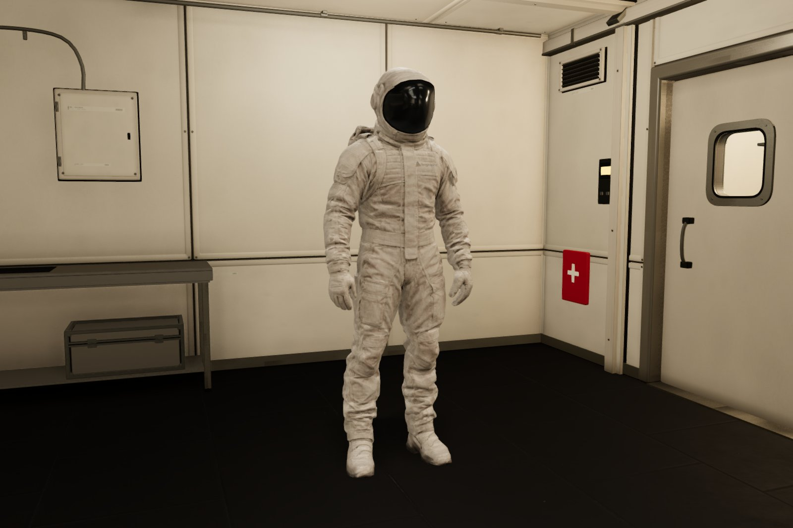
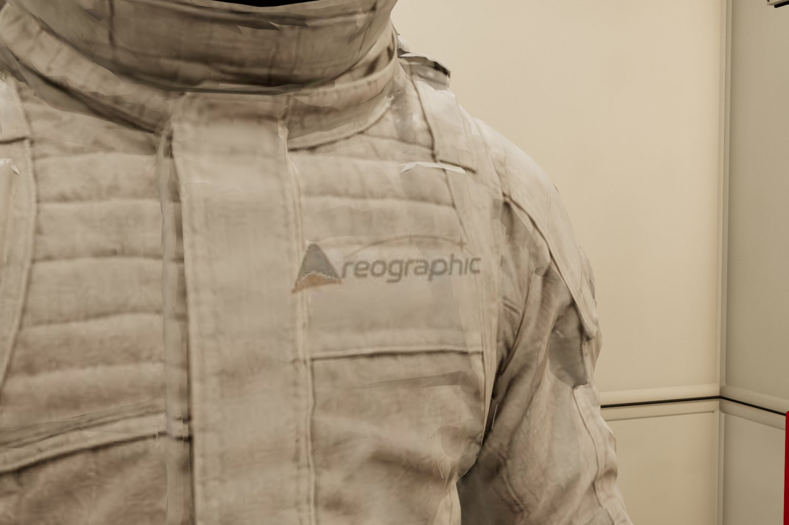

# Areographic 우주복 적용 검토

이 브랜치는 `team-navis/Areographic`의 main `e24d523`을 기준으로 합니다. 기본 대원 모델을 아래 최종 우주복으로 바꿉니다. main 병합이나 Pages 배포는 수행하지 않았습니다.

## 변경 결과

- 옷 위에 떠 보이던 별도 와펜을 없애고, Areographic 로고를 옷감의 색상 텍스처에 통합했습니다. 주름·명암·노멀·거칠기가 로고에서도 이어집니다.
- 얼굴 메시와 전용 얼굴 이미지는 없습니다. 옷/헬멧 외피, 독립 바이저, 고무 실링, 어두운 내부 라이닝의 4개 메시입니다.
- 바이저의 투과·반사·굴절값을 유지합니다. 유리는 불투명 그림자와 실내 AO에서 제외하고, 옷감에는 기존 실내 간접광을 적용합니다.
- 기본 로딩 경로와 Draco 디코더는 `assetUrl()`을 사용해 `/Areographic/` 배포 경로를 지원합니다.
- `?suit=mark3`로 기존 NASA 모델을 비교할 수 있습니다. 새 GLB 로딩에 실패해도 NASA 모델로 자동 대체됩니다.

## 파일 및 용량

| 항목 | 값 |
| --- | --- |
| 파일 | `public/models/areographic/integrated-suit.glb` |
| 용량 | 1,066,884 바이트, 약 1.07 MB |
| 메시 / 삼각형 | 4 / 51,716 |
| 색상 / 노멀 / ORM 텍스처 | 3072 / 1024 / 384 px |
| 압축 | Draco 메시, GLB에 포함된 JPEG·PNG 텍스처 |
| SHA-256 | `f871f7dfc36b0dd1b2a9fbd24b96be8bbcbda8d5761b0d18e8f91e6570909f80` |

직전 로컬 디자인 시안인 Clean v6(4,898,948바이트) 대비 78.22% 줄었습니다. **기존 main의 NASA 모델 대비 감소율은 아닙니다.** NASA 파일은 비교/실패 시 대체용으로 남기므로 저장소와 배포 산출물에는 새 GLB 약 1.07 MB가 추가됩니다. 정상 실행에서는 기본 모델 하나만 요청합니다. 아래 검토용 JPG는 `docs/`에 있어 Vite 배포에 포함되지 않습니다.

## 확인 방법

```sh
git fetch origin
git switch --track origin/feat/integrated-spacesuit
npm ci
npm test
npx vite --host 127.0.0.1 --port 5173 --strictPort
```

`http://127.0.0.1:5173/`에서 Enter로 시작해 우주복과 가슴 로고를 확인합니다. 대원을 선택하면 실내 1인칭으로 전환되며 모델은 시야에서 숨겨집니다. `http://127.0.0.1:5173/?suit=mark3`는 비교용입니다.

Pages 경로 검증:

```sh
npm run build -- --base=/Areographic/
npx vite preview --host 127.0.0.1 --port 43817 --strictPort --base=/Areographic/
# 다른 터미널, macOS/Linux:
MW_URL=http://127.0.0.1:43817/Areographic/ node tests/areographic-suit.capture.mjs
# PowerShell:
$env:MW_URL='http://127.0.0.1:43817/Areographic/'
node tests/areographic-suit.capture.mjs
```

브라우저 검증은 로컬 Chrome을 사용합니다. 변경 범위 밖의 독립 관제 지도 iframe과 외부 폰트 요청은 제외합니다. 실제 브랜치의 프로덕션 번들을 실행하며 모델이나 소스를 요청 가로채기로 교체하지 않습니다.

## 검증과 화면

- `npm test`: 42개 통과.
- `/Areographic/` 기준 프로덕션 빌드 통과. 기존 대형 JavaScript 청크 경고는 남아 있습니다.
- 프로덕션 Chrome 확인 통과: 기본 모델의 4개 메시·51,716 삼각형, 유리 그림자/간접광 제외, 호버 후 재질 유지, 대원 1인칭 전환, 명시적 NASA 비교 및 GLB 404 시 자동 대체. 기본 경로의 앱 오류와 실패한 자산 요청은 0개입니다.
- 브라우저 확인 결과와 재현 스크립트: [verification.json](review/areographic-suit/verification.json), [capture script](../tests/areographic-suit.capture.mjs).





## 출처와 한계

팀이 승인한 생성형 전신 참고 이미지를 바탕으로 로컬 TRELLIS.2로 재구성하고 Blender/Python으로 다듬었습니다. 기존 EVOVA 모델이나 NASA Mark III를 개조한 파일이 아닙니다. [provenance.json](../public/models/areographic/provenance.json)에 최종 파일 정보와 가공 내역을 기록했습니다. 원본 얼굴 참고 사진·생성 모델 가중치·개인 파일은 이 브랜치에 포함하지 않습니다.

정적 디자인 프로토타입입니다. 리깅·보행·착석 애니메이션은 없고, 전면 텍스처에 참고 이미지의 조명이 일부 남아 있습니다. 측면과 후면은 이미지 기반 재구성이며, 극단적인 근접 확대에서는 텍스처와 메시의 한계가 보입니다. 실제 우주복의 설계나 성능을 나타내지 않습니다.

병합 시 이 브랜치 전체를 main에 병합하면 됩니다. 모델만 옮길 경우 로더와 실내 유리 처리도 함께 필요합니다. Pages는 기존 수동 배포 워크플로를 따릅니다.
